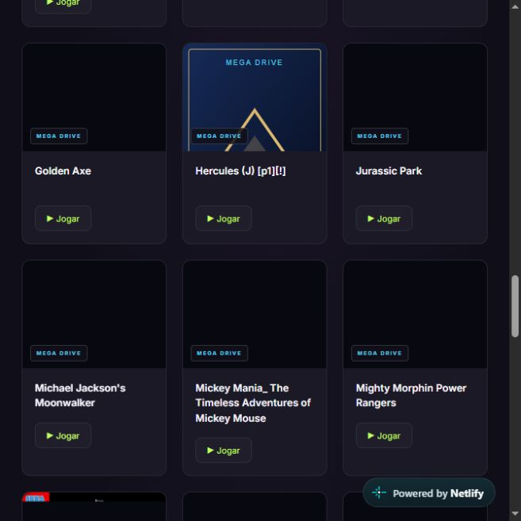

# Retro Station

Biblioteca de jogos retrô no navegador, com uma interface em português, busca, seleção de consoles e integração com o [EmulatorJS](https://github.com/EmulatorJS/EmulatorJS).

**[Abrir demonstração online](https://retro-station.netlify.app/)**



## A experiência

- Seleção de NES, Super Nintendo, Mega Drive e Game Boy.
- Busca por nome, cards com capas e jogo em destaque.
- Navegação entre destaques e escolha aleatória.
- Execução em um player integrado, com opção de tela cheia.
- Catálogo gerado a partir da pasta local `roms/`.
- Build estático para publicação em serviços como Netlify.

O projeto está na **V1**, com finalidade acadêmica e experimental, sem monetização. O motor de emulação é o EmulatorJS; este repositório reúne a interface, a organização do catálogo e a integração do player. A implementação foi desenvolvida com apoio do Codex, agente de IA, sob orientação do autor.

## Tecnologias

| Camada | Tecnologia |
| --- | --- |
| Interface | HTML, CSS e JavaScript com módulos ES |
| Emulação | EmulatorJS carregado por CDN |
| Ferramentas locais | Node.js e npm |
| Verificações | Node.js Test Runner |
| Publicação | Arquivos estáticos no Netlify |

## Executar localmente

Requer Node.js com suporte aos scripts de teste utilizados; a versão verificada para esta publicação foi **Node.js 24**. Não há dependências npm externas para o servidor ou o build.

```bash
git clone https://github.com/WeldonCarlos/retro-station.git
cd retro-station
npm start
```

Abra **http://localhost:3000**. A primeira execução cria as pastas locais de ROMs e imagens e atualiza o catálogo. O checkout inicial não inclui jogos.

## Configurar sua coleção

Adicione somente arquivos que você tenha autorização para utilizar:

```text
roms/
  nes/           # .nes ou .zip
  snes/          # .sfc, .smc ou .zip
  megadrive/     # .md, .gen, .smd, .bin ou .zip
  gb/            # .gb, .gbc ou .zip
images/
  segaMD/
  snes/
```

A pasta `megadriver/` também é reconhecida como Mega Drive.

```bash
npm run catalog
```

O catálogo mantém os metadados já existentes para cada arquivo. Uma capa PNG pode ser adicionada em `images/<core>/<nome-da-rom-sem-extensão>.png`, usando `segaMD` para Mega Drive. Para outros arquivos de imagem, configure o campo `cover` do item correspondente no `catalog.json`.

Os jogos, BIOS e capas da coleção online não são distribuídos neste repositório. Os direitos dos jogos e de seus elementos visuais pertencem aos respectivos titulares.

## Comandos

| Comando | Finalidade |
| --- | --- |
| `npm start` | Atualiza o catálogo e inicia o servidor local |
| `npm run catalog` | Reconstrói o catálogo |
| `npm run check` | Verifica a sintaxe dos scripts |
| `npm test` | Verifica nomes de ROMs e validação de caminhos |
| `npm run build` | Gera `dist/` |
| `npm run publish:prepare` | Gera `publicar/` |

## Publicar no Netlify

```bash
npm run build
```

Publique **o conteúdo da pasta `dist/`** no projeto do Netlify. O pacote usa o catálogo atual e inclui apenas as ROMs catalogadas. PlayStation 1 está desativado nesta versão.

A publicação de uma coleção inclui os arquivos locais adicionados a ela. O tamanho de cada ROM afeta o tempo de carregamento do jogo e o tráfego transferido pela hospedagem.

## Organização

```text
index.html            Interface da biblioteca
style.css             Identidade visual e responsividade
app.js                Busca, filtros e seleção de jogos
player.html / .js     Integração com EmulatorJS
rom-path.js           Validação dos caminhos de ROMs
rom-path.test.js      Testes da validação
generate-catalog.js   Leitura da coleção local
server.js             Servidor HTTP de desenvolvimento
prepare-publish.js    Preparação do pacote estático
catalog.json          Metadados dos jogos
```

## Verificações e limites

Os testes cobrem nomes com pontuação, a aceitação dos caminhos do catálogo e a rejeição de caminhos indevidos. Eles não verificam a compatibilidade de cada jogo com o emulador.

O EmulatorJS é baixado de uma CDN, portanto a execução depende de conexão e disponibilidade desse serviço. Progresso e controles são gerenciados pelos recursos do emulador e pelo navegador; não existe sincronização de conta própria.

## Próximas evoluções

Melhorar navegação, apresentação visual, compatibilidade entre dispositivos e organização das coleções, com validação prática antes de cada publicação.

## Autor

[Weldon Carlos](https://github.com/WeldonCarlos) · [LinkedIn](https://www.linkedin.com/in/weldon-carlos-41b488231/)

